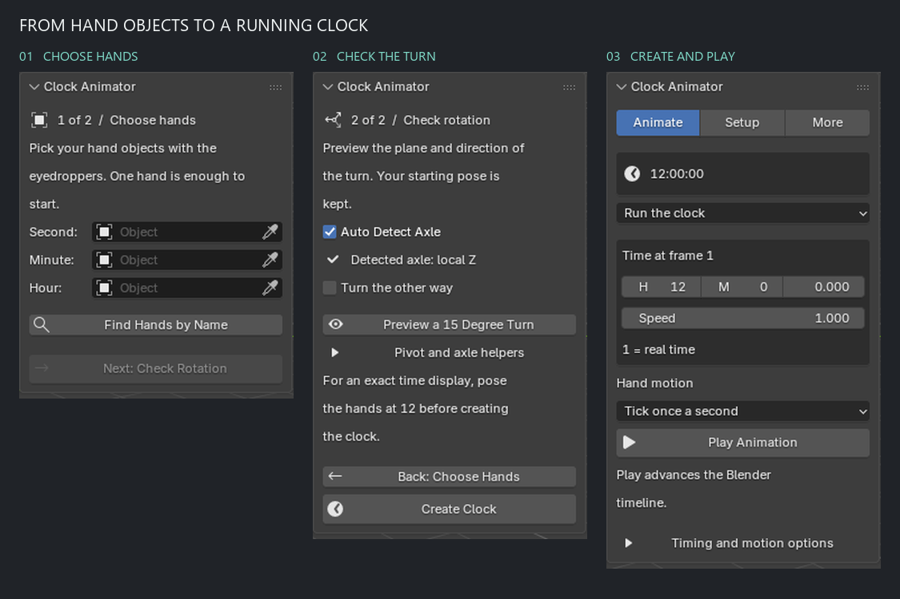
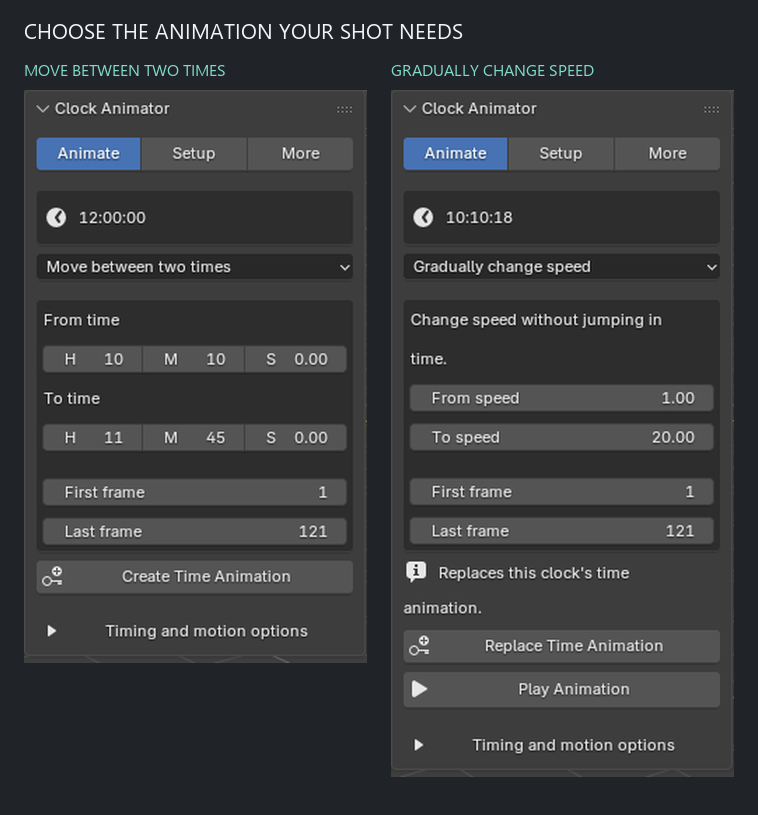
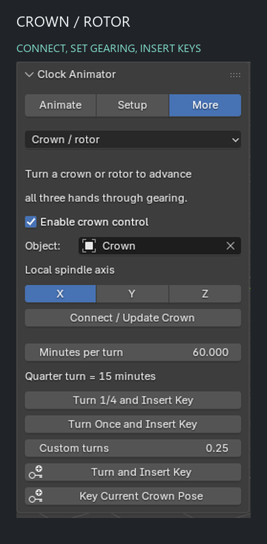
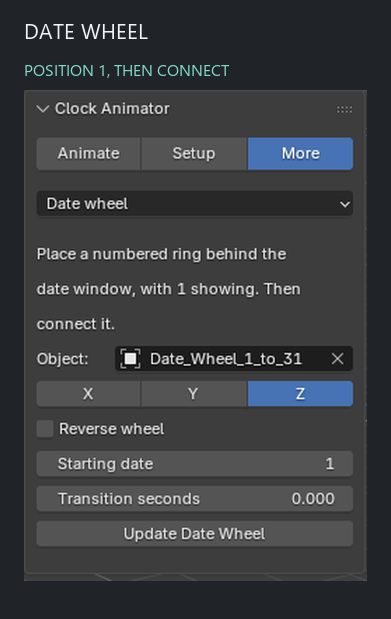
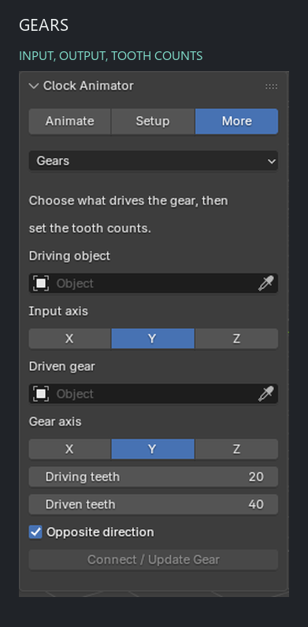
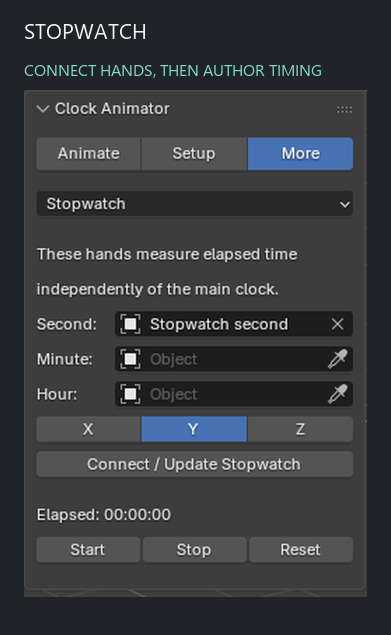
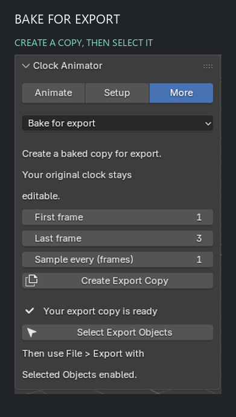

# Clock Animator

### One clock. Every hand in sync.

Animate watch and clock hands in Blender, from a quiet ticking second hand to a
fast crown adjustment, a midnight date change, or a coordinated product shot.

**Blender 4.2 and newer** · **GPL-3.0-or-later**

**Choose hands → Check rotation → Create Clock → Play Animation**



> [!TIP]
> **You do not need to learn every tool to animate a clock.**
> Start with [Your first clock](#your-first-clock). Crown, date, gears, stopwatch,
> and export are available later under **More**.

| Your goal | Start here |
| --- | --- |
| Get a watch moving for the first time | [Install](#install), then [Your first clock](#your-first-clock) |
| Make a specific animation | [Choose an animation](#choose-an-animation) or [Worked recipes](#worked-recipes) |
| Fix an unexpected result | [Troubleshooting](#troubleshooting) |
| Understand the full feature set | [Feature map](#feature-map) |
| Inspect implementation and verification | [Technical reference](#technical-reference) |

---

## Install

1. Open the **[latest release](https://github.com/its-niloy/Clock-Animator/releases/latest)** and download the **Clock Animator add-on ZIP** listed under Assets.
2. In Blender, open **Edit → Preferences → Get Extensions**.
3. Open the menu at the top right and choose **Install from Disk**.
4. Select the ZIP and install it. Enable **Clock Animator** if Blender has not enabled it automatically.
5. Return to the **3D Viewport**, press **N**, and select the **Clock** sidebar tab.

Keep the ZIP intact when installing. Blender reads the extension package directly.
The official [Blender extension guide](https://docs.blender.org/manual/en/4.2/editors/preferences/extensions.html)
describes the native installation interface.

### Updating an existing installation

Install the new ZIP through **Install from Disk**, allow replacement if prompted,
and restart Blender. Open your saved scene afterward.

Your existing controller, hand rest poses, crown reference and authored time
curves are retained by a normal rig update. If the panel requests an update,
choose **Setup → Update Clock**. For the supplied watch model, keep
**Auto Detect Axle** enabled so its local Z spindle is selected.

---

## Your first clock

### Before opening the panel

You need separate objects for the hands you want to animate. One hand is enough;
second, minute and hour hands can all be assigned together.

| Check | Why it matters |
| --- | --- |
| Each hand is a separate object | Each object receives its own rotation |
| Each hand's origin is at the dial center | Blender rotates an object around its origin |
| The hands are posed at 12 for exact time readings | The modeled rest pose defines zero; the clock time is added to it |
| You are working with local, editable objects | The add-on preserves linked/library data rather than overwriting it |

An **origin** is the object's small pivot point. It should sit where the hand
attaches to the spindle, rather than halfway along the hand.

> [!TIP]
> **Already modeled a watch showing 10:10?** Its pose is kept during setup.
> The time display represents the rotation added to the model's rest pose. To make
> the dial match absolute times such as 10:10 precisely, prepare the rest pose with
> all hands pointing at 12 before creating the rig.

### Step 1 · Choose hands

1. Open **N → Clock** in the 3D Viewport.
2. Use the eyedropper beside **Second** to pick your second-hand object.
3. Repeat for **Minute** and **Hour**, if present.
4. Click **Next: Check Rotation**.

Leave any unused hand slot empty. Each populated slot must contain a different object.

**Using ordinary object names is fine.** A hand called `Circle.028` can be picked
with the eyedropper. The optional **Find Hands by Name** button is useful when
selected objects contain recognizable tokens such as `sec`, `min`, `hour` or `hr`.
It does not guess roles from selection order.

### Step 2 · Check rotation

1. Leave **Auto Detect Axle** enabled for flat mesh hands.
2. Read the detected local axis beneath it.
3. Click **Preview a 15 Degree Turn**.
4. Check the wireframe copy: it should stay flat on the dial and turn in the direction you want.
5. Enable **Turn the other way** if the direction is reversed.
6. Click **Create Clock**.

The preview is a temporary wireframe copy. Your original hands stay in place.
Creating the clock clears the generated preview automatically. **Back: Choose
Hands** lets you revise the assignments and clears the preview as well.

You can create the clock without running the preview if you already know the alignment.

### Step 3 · Press Play

The panel switches to **Animate**.

1. Keep **Run the clock** selected.
2. Set the time in **Time at frame …**, if desired.
3. Leave **Speed** at `1` for real-time motion.
4. Choose a **Hand motion** preset.
5. Click **Play Animation**.

The button starts Blender's timeline. While it is playing, the button becomes
**Stop Playback**. Scrubbing the timeline also updates the hands.

**You now have a working clock.** The remaining tools can be explored whenever a shot needs them.

---

## Know your three pages

| Page | Use it for | What stays visible |
| --- | --- | --- |
| **Animate** | Everyday playback, a time-to-time shot, or a speed ramp | Live time and the controls for the selected animation task |
| **Setup** | Reassigning hands, fixing axes/direction, checking pivots | Hand pickers, alignment, preview and **Update Clock** |
| **More** | Optional parts, export and clock management | One selected tool at a time |

The **More** menu contains **Crown / rotor**, **Date wheel**, **Gears**,
**Stopwatch**, **Bake for export**, and **Manage clocks**.

When a scene has multiple clock controllers, a **Clock** picker appears above the
three pages. Selecting a clock restores its saved hand, crown, axis and animation
settings. With one clock, the picker stays in **More → Manage clocks**.

### Feature map

| Feature | Where to find it |
| --- | --- |
| [Live HH:MM:SS display](#run-the-clock) | **Animate**, above the animation task |
| [Constant speed, reverse time or stopped clock](#run-the-clock) | **Animate → Run the clock → Speed** |
| [Animate from one time to another](#move-between-two-times) | **Animate → Move between two times** |
| [Accelerate or slow down](#gradually-change-speed) | **Animate → Gradually change speed** |
| [Quartz, mechanical stepping, smooth sweep](#choose-how-the-hands-move) | **Animate → Hand motion** |
| [Clock hold and resume](#hold-and-resume-clock-time) | **Animate → Timing and motion options** |
| [Tick rebound and settling](#add-a-subtle-tick-rebound) | **Animate → Timing and motion options** |
| [Stable long rotations](#stable-long-rotations) | **Animate → Timing and motion options** |
| [Crown/rotor gearing and rotation keys](#animate-a-crown-or-rotor) | **More → Crown / rotor** |
| [Existing or generated date ring](#add-a-date-wheel) | **More → Date wheel** |
| [Additional gears and gear chains](#connect-visible-gears) | **More → Gears** |
| [Independent stopwatch hands](#add-an-independent-stopwatch) | **More → Stopwatch** |
| [Alignment preview and pivot helpers](#fix-alignment-and-pivots) | **Setup** |
| [Separate baked export copy](#bake-a-separate-export-copy) | **More → Bake for export** |
| [Rename, select, create or remove a rig](#manage-several-clocks) | **More → Manage clocks** |

---

## Choose an animation



### Run the clock

Choose **Animate → Run the clock** for continuous motion at a constant rate.

**Time at frame …** is the time at the rig's anchor frame. A new rig normally
uses the scene's first frame. If you are already viewing a later frame, the live
readout includes the time that has elapsed since that anchor.

| Speed | Result |
| --- | --- |
| `1` | One clock second per real second |
| `10` | Ten times real time |
| `60` | One clock minute per real second |
| `0` | Hold ordinary clock time; crown input can still advance it |
| `-1` | Run backwards at real-time speed |

Editing Speed changes the timeline-to-time mapping. For a gradual acceleration,
use **Gradually change speed** instead.

The live readout is the current calculated time. It is separate from the anchor
time fields and uses a 24-hour HH:MM:SS display.

#### Start at your computer's local time

Open **Timing and motion options → Start at My Local Time**.

This captures the computer's current local time and anchors it to the frame you
are viewing. It also recalibrates the crown's zero angle. The saved animation
then follows Blender's timeline; it is not a continuously connected wall clock.

### Move between two times

Use this for product reveals, time-lapse shots and precise transitions.

**Example: 10:10 → 11:45 over frames 1–121.**

1. Choose **Animate → Move between two times**.
2. Enter **From time** as `H 10`, `M 10`, `S 0`.
3. Enter **To time** as `H 11`, `M 45`, `S 0`.
4. Set **First frame** to `1` and **Last frame** to `121`.
5. Open **Timing and motion options** if you want to change **Easing**.
6. Click **Create Time Animation**.
7. Click **Play Animation**, or scrub between the first and last frames.

The first frame shows the starting time; the last shows the ending time. Before
or after the range, the authored time holds at the corresponding endpoint.

| Easing | Appearance |
| --- | --- |
| **Linear** | Constant rate of time change |
| **Ease in and out** | A softer start and finish |

#### Cross midnight

To animate from **23:50 to 00:10 the following day**, set the two times and choose
**Timing and motion options → Extra days = 1** before creating the animation.

Extra days is a signed day offset. Use `0` for the same day, positive values for
later days, and negative values for earlier days. A lower ending time with zero
extra days animates backwards within the same day.

> [!IMPORTANT]
> **Replace Time Animation** replaces this clock's existing elapsed-time curve.
> It preserves the rig and the crown action. Use Blender's Undo if you need to
> recover the previous curve.

### Gradually change speed

Use this when the clock should accelerate or slow down without jumping in time.

**Example: real time → 20× speed over five seconds.**

1. Choose the scene's frame rate before building the animation.
2. At **24 fps**, choose **Animate → Gradually change speed**.
3. Set **From speed = 1** and **To speed = 20**.
4. Set **First frame = 1** and **Last frame = 121**.
5. For a mathematically linear speed change, choose **Timing and motion options → Easing → Linear**.
6. Click **Create Time Animation** and play it.

This range spans five seconds between its endpoints. A linear ramp from 1× to
20× advances the clock by **52.5 seconds** during those five seconds. After the
range, the clock continues at 20× speed.

The ramp is anchored to the existing base clock value at its first frame.
Negative speeds are supported. Changing FPS afterward does not rebuild a saved
time curve; rebuild the ramp if its intended duration changes.

### Hold and resume clock time

1. Move the playhead to the frame where the clock should stop advancing.
2. Open **Animate → Timing and motion options**.
3. Click **Hold Clock at This Frame**.
4. Move to a later frame.
5. Click **Resume Clock From Here**.

Earlier motion is preserved. Resume continues at the displayed Speed. Crown
adjustments can still change time while the ordinary clock motion is held.

**Stop Playback** stops Blender's timeline. **Hold Clock at This Frame** authors
a clock-time hold that remains in the animation when you render or scrub it.

#### Return from a custom animation to a running clock

Choose **Run the clock → Use a Running Clock**. The current base time is kept and
continues at the playback speed. Until you switch, the UI explains that a custom
time animation is active and hides the ineffective starting-time/speed controls.

---

## Choose how the hands move

In the running-clock view, open **Hand motion** and choose a preset. The choice
applies immediately. For shots and ramps, find Hand motion under **Timing and
motion options**.

| Preset | What you see |
| --- | --- |
| **Tick once a second** | A quartz-style step each clock second |
| **Mechanical: 6 steps** | Six small steps per clock second |
| **Mechanical: 8 steps** | Eight small steps per clock second |
| **Smooth sweep** | Continuous movement |

All three main hands follow the same time source. Their relative speeds remain
coordinated when you change Speed, create a shot, or turn the crown.

### Add a subtle tick rebound

1. Select a ticking or mechanical preset.
2. Open **Timing and motion options**.
3. Increase **Tick rebound** slightly; start with a small angle such as `0.2°`.
4. Adjust **Settling** to control how quickly the rebound fades.
5. Preview at the scene's actual FPS.

Rebound is cosmetic motion on the main second hand. Its default is zero.
The minute and hour hands, and clock-driven gear timing, follow the nominal
stepped time. Choose Smooth sweep when you want motion without tick rebound.

### Stable long rotations

**Stable long rotations** is enabled for new clocks. It keeps displayed hand
angles within a turn, reducing the loss of precision caused by very large angle
values. After changing it, click **Apply Precision Setting**.

This does not remove Blender's single-precision limits. For export, use the
baked-copy workflow, which maintains sampled rotation continuity across turns.

---

## Animate a crown or rotor

**Path: More → Crown / rotor**



The crown is an input object. Turning it advances the second, minute and hour
hands together through adjustable gearing. Ordinary clock playback leaves the
crown rotation under your control.

### Connect the input object

1. Turn on **Enable crown control**.
2. Pick the crown or rotor in **Object**.
3. Choose its **Local spindle axis**. This can differ from the hands' axis.
4. Leave the crown in the neutral pose you want to use as zero.
5. Click **Connect / Update Crown**.

Connect before keyframing. The add-on prepares an unanimated crown's Euler order
while preserving its pose. If rotation keys already exist in an incompatible
mode, it asks you to prepare the correct mode first rather than overwriting them.

### Understand the gearing

**Minutes per turn** tells you how much clock time one full crown revolution adds.

| Minutes per turn | One full turn | A quarter turn |
| --- | --- | --- |
| `60` | 1 clock hour | 15 clock minutes |
| `120` | 2 clock hours | 30 clock minutes |
| `-60` | 1 clock hour backwards | 15 clock minutes backwards |

At the default 60, a quarter turn produces **15 second-hand revolutions**,
**90° of minute-hand movement**, and **7.5° of hour-hand movement**.

### Make a crown-adjustment shot

1. In **Animate → Run the clock**, set **Speed = 0** for crown-only time changes.
2. Choose **Smooth sweep** for continuous hand movement.
3. Return to **More → Crown / rotor**.
4. Go to frame `1` and click **Key Current Crown Pose**.
5. Go to frame `49` at 24 fps.
6. Click **Turn 1/4 and Insert Key**.
7. Play the timeline to see the adjustment over two seconds.

The turn buttons rotate and key the crown at the current frame. Moving the
playhead between clicks creates the animation. Repeated clicks at the same
frame update that frame's pose.

Use **Custom turns** with **Turn and Insert Key** for a signed number of
revolutions. Multiple turns work because the input reads the unwrapped Euler
rotation channel. You can also rotate the crown manually and insert normal keys.

To disconnect it, disable **Enable crown control** and click **Disconnect Crown**.
The input object and its rotation action remain in the scene.

---

## Add a date wheel

**Path: More → Date wheel**



The date mechanism rotates a ring of static numbers through the date window.
The add-on can create one mesh containing **1–31** and its backing ring.

### Create a numbered wheel

1. Set **Wheel radius** to suit your model's scale.
2. Click **Create a Numbered Wheel**.
3. Position and rotate it behind the watch's date aperture.
4. Place **1** under the date window in its rest pose.
5. Keep local **Z** as the axis for the generated wheel.
6. Click **Connect Date Wheel**.

The generated wheel is placed at the 3D cursor. Its numerals are mesh geometry,
so the completed object rotates as a unit. If it is too large, Undo and create
it again with a smaller radius, or scale it before connecting.

### Connect a wheel you already modeled

Pick it in **Object**, choose its local spindle axis, position 1 at the window,
and click **Connect Date Wheel**. Enable **Reverse wheel** if your number layout
needs the opposite rotation direction.

| Setting | Meaning |
| --- | --- |
| **Starting date** | The date assigned to clock day zero; values 1–31 |
| **Transition seconds = 0** | An instant change at midnight |
| **Transition seconds > 0** | A gradual change during that many seconds before midnight |

**Example:** a transition of `60` starts moving at 23:59:00, is halfway at
23:59:30, and finishes at midnight. Backwards time and backwards crown adjustments
follow the same transition in reverse.

> [!NOTE]
> This is a repeating 31-position animation wheel. Real month lengths, leap years
> and calendar correction are outside its scope. Your dial/window geometry hides
> the other numerals; the add-on does not cut an aperture into the watch.

---

## Connect visible gears

**Path: More → Gears**



Use this for exposed mechanisms or any object that should turn at a ratio of
another object's rotation.

1. Choose the **Driving object**: a main clock hand, another connected gear, or an external input.
2. For an external input, choose its **Input axis**.
3. Choose the **Driven gear** and its **Gear axis**.
4. Enter **Driving teeth** and **Driven teeth**.
5. Keep **Opposite direction** enabled for a normal meshed pair.
6. Click **Connect / Update Gear**.

### Example · 20 teeth driving 40 teeth

| Input | Value |
| --- | --- |
| Driving teeth | `20` |
| Driven teeth | `40` |
| Opposite direction | Enabled |
| Result | Half the input's angular speed, in the opposite direction |

Choose the main second hand as the source: a 90° change in that hand's nominal
motion produces a 45° change in the gear in the opposite direction.

To make a chain, connect another gear using the first gear as its Driving object.
Changing upstream gearing propagates the appropriate rate and position offset
through the chain. Self-connections and transform cycles are rejected.

### External animated inputs

Prepare the input's Euler mode before keyframing it:

| Input axis | Required rotation mode |
| --- | --- |
| X | XYZ Euler |
| Y | YXZ Euler |
| Z | ZXY Euler |

Clock-driven gears use unwrapped shared time, so a bounded hand display cannot
reset their phase at the end of a revolution. Connections are calibrated to the
pose at attachment. Updating a gear restores its saved rest pose before rebuilding.

### Disconnect a part

Select a connected optional part in the viewport. Its page offers **Disconnect
Selected Part**. Remove downstream gears before their driving gear. A clock-driven
gear with dependants must have those dependants detached before it can switch
to an external input.

---

## Add an independent stopwatch

**Path: More → Stopwatch**



1. Prepare separate stopwatch hand objects.
2. Assign Second, Minute and/or Hour and choose their local axis.
3. Click **Connect / Update Stopwatch**.
4. At the starting frame, click **Start**.
5. Move to the stopping frame and click **Stop**.
6. Click **Start** later to resume, or **Reset** to return to zero.

The commands write timing decisions at the current frame. They do not start or
stop Blender's timeline. Use **Play Animation** on Animate, or Blender's timeline
controls, to preview the result.

| Command | Authored behavior |
| --- | --- |
| **Start** | Continue from the current elapsed value |
| **Stop** | Hold the elapsed value |
| **Reset** | Return to zero at this frame |

Earlier timing decisions remain; a new command replaces the future continuation
from its frame. These are saved curves, so seeking backwards gives the same
result as playing forwards.

The stopwatch is independent of normal clock and crown time. Its second hand
completes a turn in 60 elapsed seconds, minute hand in 60 minutes, and hour hand
in 12 hours. The HH:MM:SS readout wraps after 24 hours.

---

## Fix alignment and pivots

**Path: Setup**

### If a hand tilts out of the dial

1. Open **Setup** and enable **Auto Detect Axle**.
2. Run **Preview a 15 Degree Turn**.
3. If detection is ambiguous, disable Auto Detect Axle and choose X, Y or Z manually.
4. Check both the plane and direction of motion.
5. Click **Update Clock** after changing the actual rig settings.

A **local axis** belongs to the hand itself. Rotating the whole watch does not
change which local mesh axis is its spindle. For the supplied `watch 2.blend`,
all three hand meshes lie in local XY, so their correct spindle is **local Z**.

The preview and live rig use the same local-axis conversion. Existing Euler,
quaternion, axis-angle and delta rotations are preserved during setup and restored
when the rig is removed.

### If a hand orbits instead of spinning

Its origin is likely misplaced.

1. Before rigging, place the **3D cursor** at the dial center.
2. Open **Pivot and axle helpers**.
3. Click **Move Origins to 3D Cursor**.
4. Preview the turn again.

This moves the origin while keeping geometry in place and restores the prior
selection. Shared mesh data must be made single-user before moving origins.
For an already connected clock, remove its rig through **More → Manage clocks**
before changing origins, then set it up again.

**Show Axle Helpers** creates render-hidden arrows at the pivots. **Clear Preview**
removes generated helper objects while preserving unrelated objects placed in
the helper collection.

---

## Bake a separate export copy

**Path: More → Bake for export**



Use this when another application needs ordinary keyed object transforms.

1. Set **First frame** and **Last frame**.
2. Leave **Sample every (frames) = 1** for the highest frame accuracy.
3. Click **Create Export Copy**.
4. When the ready message appears, click **Select Export Objects**.
5. Use Blender's **File → Export** menu and enable the exporter's **Selected Objects** option.

The result is a separate collection with parent-free, keyed copies. The original
clock remains editable. Copy geometry data is independent; materials and image
resources retain normal shared-data behavior.

Only driven parts are copied. Add the static case, dial and other objects you
want to include in a complete watch export, while excluding the original driven
hands. This operation bakes object transforms, rather than simulations or arbitrary
procedural geometry animation.

### glTF / GLB

Enable animation export and choose **NLA Tracks** animation mode. The generated
copies use a common track name so their motion can export together. Consult
Blender's [glTF animation documentation](https://docs.blender.org/manual/en/5.1/addons/import_export/scene_gltf2.html)
if your exporter version labels these options differently.

### FBX

Enable baked animation. Use a sampling step of `1` and **Simplify = 0** when you
need to preserve the sampled motion closely. Check the exporter's frame range
and confirm the imported result in your target application.

### Sampling and verification

Every sampled world transform is compared with the live clock before the result
is delivered. Unsupported shear, which cannot be represented by ordinary
location/rotation/scale keys, causes the incomplete copy to be removed.

A larger frame step creates fewer keys but can miss ticks or rapid motion.
If rotation exceeds half a turn between samples, raise the scene frame rate or
slow the shot before baking to preserve the intended turn direction.
The verifier checks sampled frames; it does not certify every subframe or every exporter option.

The older destructive **Bake To Keyframes** operator remains available through
Blender's F3 search for scripted workflows. The sidebar uses the separate-copy
workflow so the editable original stays available.

---

## Manage several clocks

**Path: More → Manage clocks**

| Action | How |
| --- | --- |
| Rename a clock | Edit **Name** |
| Switch clocks | Choose **Clock**; with multiple rigs, the picker is also above the main pages |
| Add another clock | Click **Set Up Another Clock**, then assign its unrigged hands |
| Remove the selected rig | Click **Remove Rig / Restore Hands** |

Setting up another clock clears the panel's assignments and returns it to the
first step. It leaves existing clocks and their animation in the scene. Use a
different set of unrigged objects for the next clock.

Removing a rig restores the saved original hand poses and keeps the model.
The crown object and its authored rotation action remain. Use Blender's Undo
if you remove the wrong rig.

---

## Worked recipes

### A · A clean ticking product shot

1. Create the clock using the guided setup.
2. Choose **Run the clock**, Speed `1`, and **Tick once a second**.
3. Keep Tick rebound at `0` for a restrained movement.
4. Set the scene range and click **Play Animation**.

### B · A smooth sweeping watch

1. Choose **Run the clock**.
2. Set Speed `1` and Hand motion **Smooth sweep**.
3. Render or play the timeline at the scene's intended FPS.

### C · A fast time-lapse

1. Choose **Run the clock** and set Speed `60`.
2. Preview: one real second now advances one clock minute.
3. For an accelerating reveal, switch to **Gradually change speed** and build the ramp instead.

### D · Show a midnight date change

1. Connect a date wheel with **Starting date = 1** and **Transition seconds = 60**.
2. Choose **Move between two times**: 23:59:00 → 00:01:00.
3. Set **Extra days = 1** and a useful frame range, such as 1–121.
4. Create the animation. The wheel moves from 1 toward 2 in the minute before midnight.

### E · Turn the crown while the clock is otherwise stopped

1. Set Speed `0` and choose **Smooth sweep**.
2. Connect the crown with **Minutes per turn = 60**.
3. Key the current crown pose at frame 1.
4. At frame 49, click **Turn 1/4 and Insert Key**.
5. Play it: the input adds fifteen clock minutes over the shot.

### F · Export while keeping the rig editable

1. Finish the live clock animation.
2. Open **More → Bake for export** and sample the desired range at step `1`.
3. Create the copy, select its objects, and export those objects.
4. Continue editing the original rig when a revision arrives; bake a fresh copy afterward.

---

## Troubleshooting

| What you see | What to do |
| --- | --- |
| No Clock tab | Enable the extension, put the pointer over the 3D Viewport, press N, and check the vertical sidebar tabs |
| The old UI is still visible | Reinstall the current ZIP and restart Blender |
| Next is disabled | Assign at least one hand and resolve the inline message, such as the same object assigned twice |
| Create Clock is disabled | Check the detected axis or choose one manually; fix the setup message shown in the panel |
| A hand tilts | Use **Setup → Auto Detect Axle → Preview**; the provided watch uses local Z |
| A hand travels around the face | Move its origin to the spindle center before rigging |
| The direction is wrong | Toggle **Turn the other way** and click **Update Clock** |
| Dial position and live time disagree | The modeled rest pose may already show another time; prepare all hands at 12 for absolute readings |
| Speed seems to do nothing | A saved time animation may be active; use **Run the clock → Use a Running Clock** |
| The hands do not move while playing | Check Speed, a clock-time hold, the scene range, and the status message; a held shot endpoint is expected |
| The crown does not affect time | Connect the correct object and spindle axis, then inspect its rotation keys and Minutes per turn |
| A turn button makes a pose but no motion | Key the initial pose, move to a later frame, then turn and insert the next key |
| The crown cannot connect because it has keys | Prepare the compatible Euler mode before keyframing; preserve your existing action before changing it |
| The date changes at an unexpected time | Inspect live time, Extra days, Starting date, and Transition seconds |
| A generated date wheel is enormous | Match Wheel radius to your model's units and scale before connecting |
| A wheel shows several dates at once | Position it behind an actual aperture/window in your model |
| A gear cannot be disconnected | Detach gears driven by it first |
| The panel reports a missing/invalid driver | Review **Setup** and update the rig; inspect any deleted source object or manually edited driver |
| Origin movement is disabled or rejected | Remove the rig first, use Object Mode, and make shared/linked geometry editable as necessary |
| An export copy is rejected for shear | Resolve the distorted parent/constraint transform before baking; the original rig is retained |
| Fast exported hands flip direction | Use a denser timeline/sample rate so turns do not exceed 180° between samples |

### Save and reopen

Save the `.blend` normally. Once created, the native rig can evaluate with
**Auto Run Python Scripts** disabled and with the add-on disabled. Enable the
add-on again when you want its UI and editing tools.

Use **Remove Rig / Restore Hands** for cleanup rather than deleting the controller
in the Outliner. That lets the add-on restore the saved poses and disconnect its parts.

---

## Technical reference

<details>
<summary><strong>How time and hand rotation are calculated</strong></summary>

A render-hidden Empty stores the rig's parameters. Native simple-expression
drivers read its properties and the scene's FPS/FPS base. There are no custom
driver-namespace functions or frame-change handlers.

For a running clock:

```text
clock seconds = start_h × 3600 + start_m × 60 + start_s
              + playback_base
              + (frame - offset) × fps_base / fps × speed
```

Saved-animation mode uses the keyed elapsed-seconds curve in place of the
playback-base and frame terms. Crown input adds elapsed time from the difference
between its current angle and attachment angle.

The main hand rates are 6°/second, 6°/minute and 30°/hour. Internal crown gearing
uses second-hand turns per crown turn, numerically equal to the UI's minutes per turn.

The driven Euler axis is first in the order: XYZ for X, YXZ for Y, ZXY for Z.
Original rotation modes and delta rotations are saved for restoration. Parent
shear or uneven carrier scale can distort world-space motion; preview the result
and resolve those transforms when a rigid circular path is required.

</details>

<details>
<summary><strong>Limits and supported editing behavior</strong></summary>

- Existing output rotation animation is rejected before setup changes it.
- Controller NLA editing is unsupported; flatten that input before using clock tools. Generated export-copy NLA is supported.
- Rotation keys, driver outputs and curve frame coordinates have Blender's native precision. Very high gearing and long timelines need care.
- Stable long rotations improve displayed hand phases; ideal absolute unwrapped error below 1e-6 radians is not guaranteed. Blender 5.2 can also clamp tiny driver outputs near zero.
- Generated speed ramps sample the continuous integral at integer frames; subframe interpolation is an approximation.
- Baking, curve generation and wheel creation are synchronous. Ranges beyond one million frames or outside Blender's native frame limits are rejected.
- Date wheels repeat 31 positions; physical winding energy, crown pull positions, month lengths and automatic calendar correction are not simulated.
- Object geometry copies are independent after baking; shared materials/images need their usual Blender data-management care when edited.
- Other operating systems, every Blender release, all custom themes and every exporter option have not been verified.

</details>

### Verification

| Area | Evidence |
| --- | --- |
| Blender versions | Windows x64: 4.2.23 LTS and 5.2.3 LTS |
| Runtime regression groups | 18 original + 13 advanced + 15 audit groups per version |
| Task-flow checks | Guided setup, focused animation, immediate presets, optional-tool isolation and new-clock reset |
| Actual UI | 20 real sidebar states, Create/preset Undo and Redo, timeline Play and Stop |
| Installation | Native ZIP installer and installed source/version checks |
| File behavior | Fresh-process reopen without the add-on and with auto-run disabled |
| Export | Actual GLB and FBX export/import pose comparisons |
| Supplied watch | Preview/native local-Z comparison and thirty animated poses in Blender 5.2 |
| Precision boundary | Strict ideal unwrapped 1e-6-radian accuracy remains outside the verified limit |

The provided newer watch file cannot be read by Blender 4.2; its 4.2 axle tests
use synthetic models. Octane rendering is unverified in the isolated environment.

Read [TEST_REPORT.md](TEST_REPORT.md) for results and limitations,
[AUDIT_REPORT.md](AUDIT_REPORT.md) for the repaired defects, and
[docs/UX.md](docs/UX.md) for UI research and design decisions.

### Build and test

```powershell
python build.py --blender 'C:\Program Files\Blender Foundation\Blender 5.2\blender.exe'
python tests/run_all.py --blender '.tools\blender-4.2.23-windows-x64\blender.exe' --blender 'C:\Program Files\Blender Foundation\Blender 5.2\blender.exe' --ui
```

The builder uses Blender's extension command, with a standard-library ZIP fallback
for unsupported commands. `--plain-zip` exercises that fallback. It publishes a
complete validated archive before replacing the previous build. Distribution is
extension-only.

Development checks use Python's standard library and Blender. Ruff is optional
for linting. Test profiles, logs and GUI captures are isolated in `.tools/` and
`tests/output/`. The shipped panel lives under **Clock**, and the UI harness
selects that actual category after Blender initializes the region.

### Repository map

```text
clock_animator/          Native rig, mechanisms, properties, operators and UI
tests/                  Formula, runtime, task-flow, UI, export and installer checks
docs/UX.md              Research and interaction decisions
docs/images/            Real sidebar captures used in this guide
build.py                Extension ZIP builder
TEST_REPORT.md          Verification evidence and known limits
AUDIT_REPORT.md         Concrete findings and their fixes
dist/                   Installable extension ZIP generated by build.py
```

Clock Animator is licensed under **GPL-3.0-or-later**. See [LICENSE](LICENSE).
